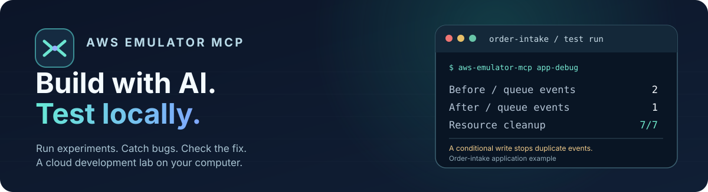
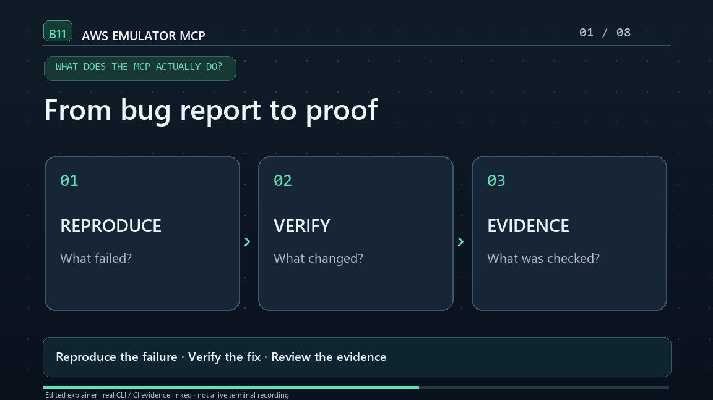
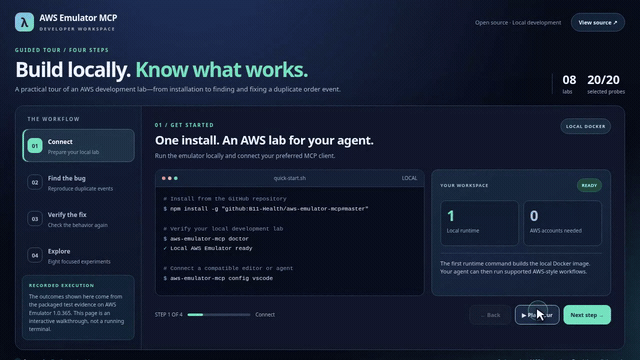
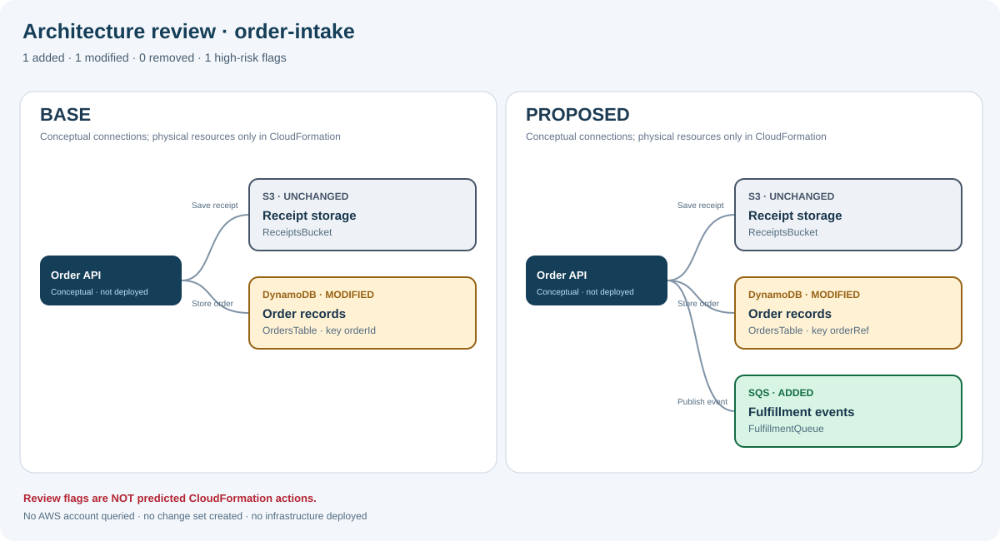
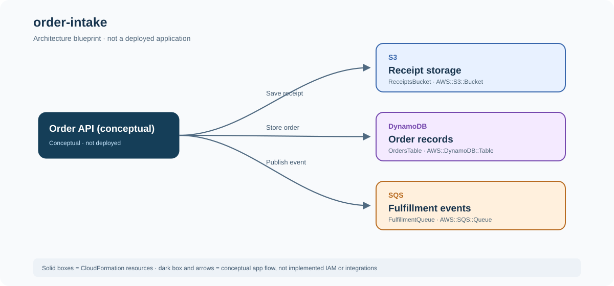
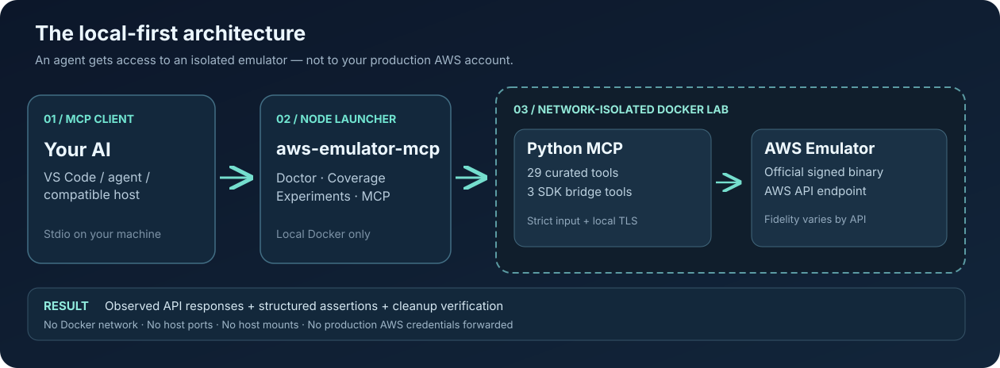

<p align="center">
  
</p>

<h1 align="center">AWS Emulator MCP</h1>
<p align="center"><strong>Your AWS playground. Controlled by your AI assistant.</strong></p>
<p align="center">
  Explore AWS APIs, test application workflows, and catch bugs before deployment.
  All from a local, isolated development environment. <strong>No AWS account required.</strong>
</p>

<p align="center">
  <a href="https://github.com/B11-Health/aws-emulator-mcp/actions/workflows/tests.yml"></a>
  <a href="LICENSE"></a>
  
</p>

<p align="center">
  <a href="https://github.com/B11-Health/aws-emulator-mcp/releases/tag/v0.4.0-beta.15">Latest GitHub release</a> ·
  <a href="#get-started">Get started</a> ·
  <a href="https://b11-health.github.io/aws-emulator-mcp/">Interactive Demo Studio</a> ·
  <a href="docs/DEMO_GALLERY.md">Watch the demos</a> ·
  <a href="docs/ONBOARDING.md#interactive-tour">Guided tour</a> ·
  <a href="docs/ARCHITECTURE_STUDIO.md">Architecture Studio</a> ·
  <a href="docs/ARCHITECTURE_REVIEW.md">PR Architecture Review</a> ·
  <a href="#connect-your-ai-assistant">Connect your assistant</a> ·
  <a href="docs/COVERAGE.md">Service coverage</a> ·
  <a href="docs/COMMUNITY_REVIEW.md">Give feedback</a> ·
  <a href="CONTRIBUTING.md">Contribute</a> ·
  <a href="SUPPORT.md">Get help</a>
</p>

## See the proof in 90 seconds

[](docs/assets/demos/proof-first-beta15.mp4)

**[Watch the narrated 87-second walkthrough](docs/assets/demos/proof-first-beta15.mp4)** · [Try the interactive Demo Studio](https://b11-health.github.io/aws-emulator-mcp/) · [Transcript and captions](docs/SHOWCASE_TRANSCRIPT.md) · [Proof and limitations](docs/SHOWCASE_EVIDENCE.md)

Start with the smallest real check on **Node.js 20+**. Docker and AWS credentials
are not required to do this first step:

~~~bash
git clone --depth 1 --branch v0.4.0-beta.15 https://github.com/B11-Health/aws-emulator-mcp.git
cd aws-emulator-mcp
node bin/aws-emulator-mcp.mjs try --json
~~~

That verifies seven generated architecture artifacts and explicitly reports the
14-step contract as **not executed**. For real emulator-backed tests, install
local Docker with **Linux containers** and run preflight followed by doctor.
The newer `master` source adds a **read-only preflight host-space advisory**
and checks **cached image source fingerprints** before reuse. Linux Engine
hosts can additionally expose a sanitized **host-visible Docker data-root
volume** reading, but no host probe proves Docker Desktop VM capacity or AWS
service fidelity. These additions
are **not in the pinned beta.15 tag**. [First-run details](docs/ONBOARDING.md).
The video is an edited, narrated explanation using actual offline CLI output
and linked project-maintained CI evidence, **not an uncut terminal capture**
or AWS fidelity certification.

## Connect to an AI assistant

**VS Code Copilot:** run **node bin/aws-emulator-mcp.mjs config copilot** to print a native mcpServers definition. **Claude Desktop:** an optional unsigned [MCPB developer preview](docs/DESKTOP_INSTALL.md) reduces JSON setup, but you still need to install and run local Docker. Neither route is a hosted public MCP endpoint or a production AWS deployment.

[**Current desktop install guide and safety limits**](docs/DESKTOP_INSTALL.md)

## Help build and test it

**Outside contributors welcome.** You do not need repository write access
or an AWS account to help. A real first-run failure report, accessibility
fix or reproducible API gap is more useful than an unverified claim.

[**Join the community**](https://b11-health.github.io/aws-emulator-mcp/#community) ·
[**Start contributing**](CONTRIBUTING.md) ·
[**Get support**](SUPPORT.md) ·
[**Browse good first issues**](https://github.com/B11-Health/aws-emulator-mcp/issues?q=is%3Aissue+is%3Aopen+label%3A%22good+first+issue%22) ·
[**Report a first-run result**](https://github.com/B11-Health/aws-emulator-mcp/issues/new?template=independent_first_run.yml)

Open requests include Windows/macOS/Linux first runs, the optional **unsigned**
Claude Desktop preview, and keyboard/screen-reader testing of the Demo Studio.
Maintainers can assign scoped tasks without granting push or admin privileges.
Independent user reports are distinguished from project-maintained CI.

## Why another MCP if AWS already supports agents?

AWS Emulator already works with AWS SDKs, the CLI and coding agents. **Use it
directly if those tools meet your needs.** This independent adapter is worth
considering when an agent needs bounded MCP operations, a reproducible
synthetic failure/repair experiment, or a read-only source-level PR review
with sanitized evidence. It is **not** an AWS compatibility layer, IAM tester,
general-purpose application runner or cloud deployment tool.

[**Compare native AWS Emulator vs this adapter: concrete tasks, commands and tradeoffs.**](docs/WHY_MCP.md)

## Explore the actual outputs first

**No AWS account, website or Docker required to inspect the artifacts.**
The [v0.4.0-beta.15 GitHub release](https://github.com/B11-Health/aws-emulator-mcp/releases/tag/v0.4.0-beta.15)
includes directly downloadable, checksum-verifiable artifacts: the actual architecture
diagram, editable draw.io source, CloudFormation YAML, an example archive,
an npm package, and checksums.

| Preview | What it proves | |
|:--|:--|:--|
| [Architecture SVG](https://github.com/B11-Health/aws-emulator-mcp/blob/v0.4.0-beta.15/examples/architecture/reference/diagram.svg) | Proposed S3, DynamoDB and SQS nodes and conceptual connections | **View** |
| [Editable draw.io diagram](https://github.com/B11-Health/aws-emulator-mcp/blob/v0.4.0-beta.15/examples/architecture/reference/diagram.drawio) | Same graph in editable source form | **Inspect** |
| [CloudFormation YAML](https://github.com/B11-Health/aws-emulator-mcp/blob/v0.4.0-beta.15/examples/architecture/reference/template.yaml) | The three actual resources the template defines | **Review** |
| [14-step AWS SDK contract](https://github.com/B11-Health/aws-emulator-mcp/blob/v0.4.0-beta.15/examples/architecture/reference/contract.json) | Separate synthetic test plan, validated with the local emulator | **Inspect** |

**Test the architecture tool without Docker or an AWS account.** On the
beta.15 checkout, one command
builds a temporary architecture, validates the seven generated artifacts and
their hashes, reports the three supported resource types and a separate
14-step **unexecuted** synthetic contract, then removes the temporary files:

```bash
git clone --depth 1 --branch v0.4.0-beta.15 https://github.com/B11-Health/aws-emulator-mcp.git
cd aws-emulator-mcp
node bin/aws-emulator-mcp.mjs try
# Sanitized, bounded proof for a developer feedback report:
node bin/aws-emulator-mcp.mjs try --json
```

This verifies only the offline architecture generator, **not** AWS API
behavior, IAM policy enforcement or a deployment. To keep and inspect the
artifacts, run `node bin/aws-emulator-mcp.mjs architecture demo`.

**Check local readiness before the large emulator build** (included in beta.15):

```bash
git clone --depth 1 --branch v0.4.0-beta.15 https://github.com/B11-Health/aws-emulator-mcp.git
cd aws-emulator-mcp
node bin/aws-emulator-mcp.mjs preflight
# Or get a bounded, sanitized report to include in a field report:
node bin/aws-emulator-mcp.mjs preflight --json
# Still useful without Docker or a global CLI installation:
node bin/aws-emulator-mcp.mjs architecture demo
```

`preflight` checks Node.js, local Docker context, **Linux-container mode** and daemon, and whether the
versioned image is cached. **It never builds or launches Docker containers.**
Without Docker, Architecture Studio still works. A successful preflight is
not a disk-capacity check, image-source verification or proof of emulator API coverage.
Docker-backed commands in the current source checkout verify a build-input
fingerprint before image reuse and rebuild stale cached bundles. This prevents
same-tag checkout collisions; it is not a security signature. [Setup details](docs/ONBOARDING.md#check-prerequisites-before-building-the-image).

**Generate all seven synchronized artifacts yourself** (Node.js 20+, Git
and npm; Docker is not needed for generation):

```bash
npm install -g "github:B11-Health/aws-emulator-mcp#v0.4.0-beta.15"
aws-emulator-mcp architecture demo
```

The application actor and diagram arrows are conceptual, **not a deployed
application or IAM wiring**. Running the generated SDK contract later
requires local Docker. No command here deploys to a real AWS account.

<p align="center">
  <a href="docs/assets/demos/product-tour.mp4">
    
  </a>
</p>
<p align="center"><sub><a href="docs/assets/demos/product-tour.mp4">Watch the guided walkthrough (25s)</a> · <a href="docs/assets/demos/fix-the-bug.mp4">Bug-fix demo (22s)</a> · <a href="docs/assets/demos/getting-started.mp4">Getting started (16s)</a> · <a href="docs/assets/demos/failure-lab.mp4">Failure Lab (20s)</a></sub></p>

## See what your agent can do

**Catch an application bug.** Our sample Python order service writes to DynamoDB, stores an S3 receipt, and sends a fulfillment message through SQS. When a client retries, the buggy version sends the event twice. A conditional DynamoDB write fixes it.

| After two identical requests | Before | After |
|:--|--:|--:|
| Accepted orders | **2** | **1** |
| SQS fulfillment messages | **2** | **1** |
| Resource cleanup checks | **7/7** | **7/7** |

The [application walkthrough](docs/APP_DEBUGGING.md) includes the Python source, exact patch, run-by-run assertions, and a [saved test result](docs/evidence/app-debug-aws-emulator-1.0.365.json). This demo runs the bundled reference fix; the MCP tool does not execute code supplied by an agent.

## Find a test for an existing Python app

On the development branch, run `node bin/aws-emulator-mcp.mjs project-plan /path/to/app`
from the MCP checkout. The command lists direct Boto3 calls with their source
locations, matches them to local SDK tests, and flags calls and arguments that
need their own tests. Directory mode reads tracked Python files. You can also
select a single module. Planning requires Python 3.10+ and works offline.
[Generate and run a contract for your app](docs/CONTRACT_TESTING.md#start-with-an-existing-python-app).

## Test your own Python handler, not just our bundled files

A first, intentionally limited **Bring Your Own App pilot** lets you
choose a trusted local Python `submit_order` function. It executes only
after an explicit terminal command, in a one-shot network-disabled Docker
container, against verified local DynamoDB, S3 and SQS APIs.

```bash
# To run the shipped examples, first open the versioned Git checkout:
git clone --depth 1 --branch v0.4.0-beta.15 https://github.com/B11-Health/aws-emulator-mcp.git
cd aws-emulator-mcp
aws-emulator-mcp app-verify examples/byo-order-handler/fixed.py --json
aws-emulator-mcp app-verify examples/byo-order-handler/buggy.py --json  # expected failure

# Or supply the actual path to a Python order handler you own:
aws-emulator-mcp app-verify /path/to/my-order-handler.py --json
```

**Compare your own trusted before/after handlers** (included in beta.15):

```bash
# From a checkout containing this feature (requires local Docker):
node bin/aws-emulator-mcp.mjs app-compare \
  examples/byo-order-handler/buggy.py \
  examples/byo-order-handler/fixed.py --markdown > byo-comparison.md
# Or export redacted machine-readable proof for a PR:
node bin/aws-emulator-mcp.mjs app-compare \
  examples/byo-order-handler/buggy.py \
  examples/byo-order-handler/fixed.py --json > byo-comparison.json
```

Each file runs against **separate ephemeral Docker labs**. A passing comparison
requires the old handler to reproduce exactly two accepted submissions and
two fulfillment messages, the new handler to pass all eight invariants, and
both runs to pass all seven cleanup checks. Output includes source hashes,
not code, payloads or SDK responses. This is **only** the order-handler pilot;
never feed untrusted PR code into this opt-in local command.

[**Source ABI, security limits, and actual 1.0.385 test evidence.**](docs/BYO_HANDLER.md)
The developer-selected fixed handler passed 8/8 functional assertions and
7/7 cleanup checks; the deliberately broken handler reproduced **two**
accepted orders and **two** SQS events. Typed tenant/customer/currency and
amount fields are included. These are **emulator application tests**, not
proof of AWS compatibility or an arbitrary repository test runner.
**Only use Python source you own and trust.** This command cannot be invoked
through the MCP server or the read-only PR Actions.

## See architecture changes *before* anyone deploys

What if an AI-generated pull request changes your infrastructure design?
**Architecture Review** shows the old and new AWS blueprint side by side,
flags potentially destructive changes, and attaches CloudFormation drafts
and editable diagrams to a read-only GitHub Actions check. No AWS account,
Docker, cloud mutations or credentials required.

[](examples/architecture/review/reference/architecture-diff.svg)

The bundled example detects a new SQS queue and a changed DynamoDB
partition key. A **high-priority review flag is a warning**, not a prediction
that AWS will replace a resource. This is a source-level diagram comparison,
**not** an AWS CloudFormation change set or deployment.

```bash
aws-emulator-mcp architecture review \
  examples/architecture/review/before.json \
  examples/architecture/review/after.json --json
```

**Use it in a GitHub pull request** (read-only repository permissions and
a full-history checkout required):

```yaml
- uses: B11-Health/aws-emulator-mcp@v0.4.0-beta.15
  with:
    manifest: .aws-emulator/architecture.json
    fail-on-risk: high
```

The `action.yml` at repository root supports this short entrypoint;
for production workflows, pin the exact 40-character reviewed commit.
See the separate project-maintained [green add-only PR](https://github.com/B11-Health/aws-emulator-mcp-action-demo/pull/1)
and [red intentionally blocked key-change PR](https://github.com/B11-Health/aws-emulator-mcp-action-demo/pull/2).
These are actual cross-repository executions, **not independent endorsements**.

[**Add the read-only PR review action to your own repo.**](docs/ARCHITECTURE_REVIEW.md)
See the [actual warning report](examples/architecture/review/reference/report.json)
and [GitHub job summary](examples/architecture/review/reference/summary.md).

## Test what happens when a cloud response is lost

Can your application recover when an AWS operation times out—or when a message
reaches SQS but its acknowledgement never reaches the caller?

```bash
aws-emulator-mcp failure-lab compare
```

The [Failure Lab](docs/FAILURE_LAB.md) reproduces a missing fulfillment event
from a fragile order workflow, verifies a recoverable pending-state approach,
and shows why an idempotent consumer matters when SQS deliveries duplicate.
The beta.15 `failure-lab partial-compare` scenario
checks a DynamoDB write followed by a failed S3 receipt upload and tests
whether retry recovers both the receipt and SQS event. See
[partial-write limitations](docs/FAILURE_LAB.md#new-partial-write-scenario-dynamodb-saved-receipt-never-uploaded).
The fault is injected at the local SDK boundary; the state changes are
verified through actual AWS Emulator APIs. [Recorded run evidence](docs/evidence/failure-lab-aws-emulator-1.0.385.json). Your agent can use
`failure_lab_catalog` to inspect both reviewed application sources and their
diff, then `failure_lab_run` to verify the measured behavior without executing
arbitrary code.

## Test an AWS workflow of your own

Go beyond the bundled demonstration. Give your agent a declarative JSON
contract that specifies AWS SDK calls, references results from previous calls,
and asserts what must be true. The runner returns per-step evidence while
executing against an isolated, fresh emulator — not your AWS account.

```bash
aws-emulator-mcp contract demo                # built-in S3 example
aws-emulator-mcp contract my-workflow.json --json
aws-emulator-mcp contract fault-demo --json  # simulate a lost SQS acknowledgement
```

The Docker MCP client exposes `contract_guide` and `contract_run`. The run
supports modeled operations across AWS SDK services, **subject to what the
emulator actually implements**, with a 16-step limit and no arbitrary script
execution. Each MCP contract receives its own ephemeral emulator state.
The contract runner also accepts one **synthetic SDK-boundary timeout**
per plan: fail before a supported write, or suppress its acknowledgement
after a successful emulated write. This lets your agent propose and replay
failure/retry experiments for AWS API workflows expressed as JSON, without
executing application source code.
[See the contract format, failure examples, and security boundaries](docs/CONTRACT_TESTING.md).

## Design infrastructure and export visual AWS diagrams

Architecture Studio compiles **one typed architecture manifest** into
CloudFormation YAML/JSON, an SVG diagram, an **editable draw.io file**, and
a separate synthetic emulator API test. The first release supports S3,
DynamoDB and SQS without needing an AWS account or Docker to generate files.

```bash
aws-emulator-mcp architecture demo
# Files appear in reports/architecture-studio/
# Open diagram.svg or edit diagram.drawio
```

[](examples/architecture/reference/diagram.svg)

The application box and arrows illustrate **conceptual flow**. Only the
S3, DynamoDB and SQS resources are represented in CloudFormation; no
application handler, IAM permissions, service integration or live stack is
created. The generated `contract.json` separately exercises synthetic AWS
SDK equivalents inside the isolated emulator when you choose to run it.

[**Inspect the manifest, template, diagrams and limits.**](docs/ARCHITECTURE_STUDIO.md)

## Make failed AWS contracts block a pull request

Your agent writes a small JSON contract, and a GitHub Action runs it in a
fresh local emulator whenever a PR opens. A failed assertion turns the check
red; a passed check includes a job summary and downloadable, **sanitized
evidence**. No AWS account or credentials are used.

```yaml
# .github/workflows/aws-emulator-contracts.yml
name: AWS Emulator contracts
on: [pull_request]
permissions:
  contents: read
jobs:
  contracts:
    runs-on: ubuntu-24.04
    steps:
      - uses: actions/checkout@3d3c42e5aac5ba805825da76410c181273ba90b1 # v7
      - uses: B11-Health/aws-emulator-mcp/.github/actions/contract-gate@v0.4.0-beta.15
        with:
          directory: .aws-emulator/contracts
```

Add 1-6 JSON files to `.aws-emulator/contracts`. You can also run
`aws-emulator-mcp gate .aws-emulator/contracts` locally before pushing.
[**Copy the workflow, choose example contracts, and inspect the security limits.**](docs/CI_CONTRACT_GATE.md)

## AWS builders: what would you change?

AWS already provides a local emulator and its own agent workflows. This is an
**independent MCP adapter**, not an AWS product or endorsement. We'd value a
hard technical review of the added layer: the isolated tool surface, bounded
failure contracts, PR-gate evidence, and first-run developer experience.

**[Give critical feedback — even if you wouldn't use it](docs/COMMUNITY_REVIEW.md).**
The [field-report form](https://github.com/B11-Health/aws-emulator-mcp/issues/new?template=field_report.yml)
asks for a concrete scenario, observations, and redacted evidence. The aim is
to learn what is useful, redundant, or misleading.

## Get started

**Requirements depend on what you want to do:** Node.js 20+ and Git are sufficient to
generate Architecture Studio artifacts. **Docker Desktop or Docker Engine is
only needed when running the local AWS Emulator** and SDK tests. The first
Docker image build requires an internet connection and sufficient free disk space.

~~~bash
npm install -g "github:B11-Health/aws-emulator-mcp#v0.4.0-beta.15"

# Run the before-and-after application test
aws-emulator-mcp app-debug compare

# Explore the available experiments
aws-emulator-mcp experiments
~~~

The launcher is currently installed from GitHub (it is **not yet published on npm**). The first runtime command builds a Docker image using the signed AWS Emulator package; later runs reuse that image. For reproducible work, keep the tag or [pin an exact tested commit](docs/DOCKER_NPM_BETA.md).

## Connect your AI assistant

~~~bash
aws-emulator-mcp config vscode
aws-emulator-mcp config copilot
~~~

Copy the generated MCP configuration into a compatible local client. It runs over standard input/output, without exposing a public server.

**Try this prompt:**

> Inspect the order-intake sample, explain why a retry publishes two fulfillment messages, and run the before-and-after test. Show me the code change and confirm whether cleanup passed.

The local MCP tools **app_debug_catalog** and **app_debug_run** expose the packaged source and its test results. [Follow the onboarding guide](docs/ONBOARDING.md) for Windows, macOS, and Linux setup.

## Explore the lab

| Workflow | Try it |
|:--|:--|
| Duplicate-order debugging | `aws-emulator-mcp app-debug compare` |
| Retry and lost-acknowledgement failures | `aws-emulator-mcp failure-lab compare` |
| SNS → SQS message delivery | `aws-emulator-mcp experiment sns-sqs-delivery` |
| EC2 network lifecycle | `aws-emulator-mcp experiment ec2-vpc-lifecycle` |
| Recover a missing S3 object | `aws-emulator-mcp experiment s3-recovery` |
| Discover the full catalog | `aws-emulator-mcp experiments` |
| Check selected AWS API responses | `aws-emulator-mcp coverage` |

Eight built-in experiments exercise S3, DynamoDB, SQS, SNS, EC2, EventBridge, SSM Parameter Store, and Secrets Manager workflows. The application debugging example uses three AWS services together. All scenarios operate on synthetic local resources and verify scoped cleanup. [Browse the demos](docs/DEMO_GALLERY.md) or [read the experiment guide](docs/EXPERIMENT_LABS.md).

## What's under the hood?

<p align="center">
  
</p>

- **29 curated MCP tools**, plus **9 Docker-only tools** for SDK discovery, API invocation, coverage, application debugging, replayable contracts and failure/recovery testing.
- **Verified stateful workflows:** reproducible order-processing bug and reference fix, a developer-selected Python order handler, isolated SDK contracts and GitHub PR review.
- **Coverage is measured per operation and application workflow—not by SDK catalog size.** An SDK model is not an implemented emulator service; passing zero-argument `List*`/`Describe*` probes does not prove write behavior, real events, IAM or AWS compatibility.
- The [exact historical read-only probe results and methodology](docs/COVERAGE.md) are available for reproducibility, **not** as a general supported-service coverage score.

The Docker integration uses local-only, network-isolated runtime containers and emulator-issued credentials. AWS Emulator is intended for development and testing, **not production AWS**; API fidelity and IAM behavior vary. See the [coverage report](docs/COVERAGE.md) and [security notes](SECURITY.md).

## Documentation and contributing

[Guided onboarding](docs/ONBOARDING.md) · [Demo gallery](docs/DEMO_GALLERY.md) · [Application debugging](docs/APP_DEBUGGING.md) · [Your Python handler](docs/BYO_HANDLER.md) · [Failure Lab](docs/FAILURE_LAB.md) · [Service coverage](docs/COVERAGE.md) · [Architecture and setup](docs/DOCKER_NPM_BETA.md) · [Contributing](CONTRIBUTING.md) · [Issues](https://github.com/B11-Health/aws-emulator-mcp/issues)

---

<sub>AWS Emulator MCP is an independent open-source integration maintained under the B11-Health GitHub account. AWS Emulator itself is an <a href="https://github.com/aws/aws-emulator">AWS project</a>. This integration is not affiliated with or endorsed by AWS.</sub>
