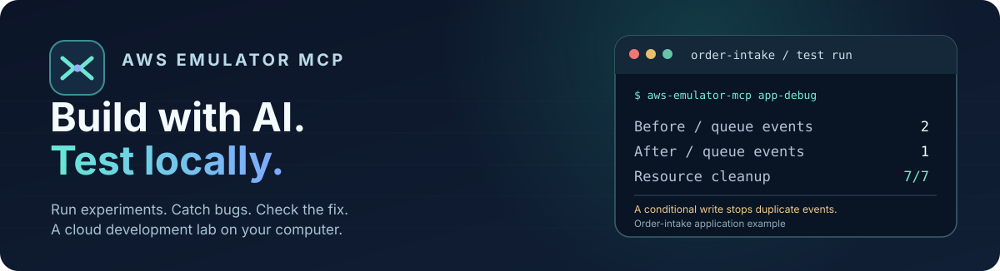
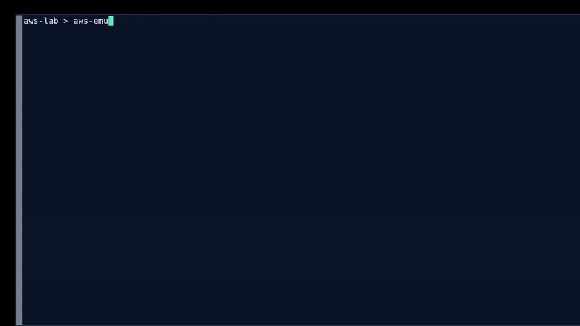
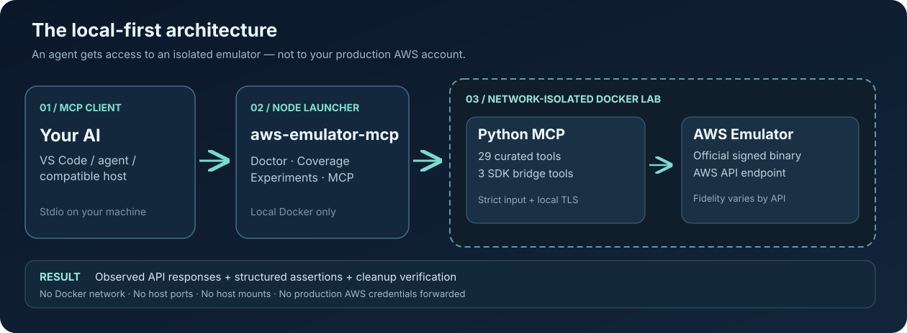

  

<h1 align="center">AWS Emulator MCP</h1>

<strong>Your AWS playground. Controlled by your AI assistant.</strong>

Explore AWS-style APIs, test application behavior, reproduce failures, and verify cleanup against an isolated <a href="https://github.com/aws/aws-emulator">official AWS Emulator</a> instance. <strong>No AWS account. No production AWS credentials. No AWS service charges for emulated resources.</strong>

  
  
  
  
  

  <a href="#quick-start">Quick start</a> ·
  <a href="#watch-the-real-cli-demo">Live CLI demo</a> ·
  <a href="#how-much-of-aws-can-it-reach">AWS coverage</a> ·
  <a href="#connect-an-ai-agent">Connect your agent</a> ·
  <a href="docs/COVERAGE.md">Measured API probes</a> ·
  <a href="CONTRIBUTING.md">Contribute</a>

> [!IMPORTANT]
> **Developer beta · source distribution.** The npm package name is **not yet published on npm** and there is **no official prebuilt Docker image** for this integration. Install this repository directly from GitHub. AWS Emulator is a separate, AWS-maintained engine; our MCP bridge is independent and is not affiliated with or endorsed by AWS.

## What makes it useful?

- **Ask an agent to explore AWS APIs, not just recite documentation.** Browse the installed AWS SDK's service models, select modeled operations, and invoke them against an **emulated localhost endpoint**—without using a real AWS profile.
- **Measure what actually works.** A built-in, read-only coverage probe runs 20 allowlisted operations and reports their observed outcomes, separately from the much larger SDK model inventory.
- **Run reproducible experiments.** Give an agent eight synthetic missions across eight service families: the original S3/DynamoDB/SQS flows plus actual SNS-to-SQS delivery, EC2 VPC/subnet/security-group lifecycle, EventBridge event-bus ingestion, SSM parameters, and synthetic Secrets Manager values. Each returns assertions, expected errors, timing, and scoped cleanup evidence.
- **Verify a real application bug and patch.** Run a Python order-intake application twice: a duplicate retry emits **two SQS fulfillment messages**; a DynamoDB conditional-write reference patch emits **one**, with both runs independently verifying all resource cleanup.
- **Keep the boundary visible.** The default Docker lab has no external network, host file mounts, forwarded ports, or production AWS credentials. It uses a signed official AWS Emulator binary.

## Quick start

**Requirements:** Node.js 20+, a running **local** Docker daemon (Docker Engine or Desktop), and network access for the first verified emulator download. The signed emulator makes the built Docker image roughly **1.25 GB**. The end-to-end Docker path has been exercised on Linux; a truly independent first-run Windows/macOS Docker acceptance test remains open.

~~~bash
# Source-only beta; this is NOT an npm registry package.
npm install -g "github:B11-Health/aws-emulator-mcp#master"

aws-emulator-mcp doctor                      # Verify the isolated local emulator
aws-emulator-mcp coverage                    # 20 real read-only API probes
aws-emulator-mcp experiments                 # See the available lab missions
aws-emulator-mcp experiment s3-recovery       # Reproduce a 404, repair it, verify cleanup
aws-emulator-mcp experiment sns-sqs-delivery   # Prove a published SNS event arrives in SQS
aws-emulator-mcp experiment ec2-vpc-lifecycle  # Create/inspect/remove a VPC, subnet and security group
aws-emulator-mcp app-debug compare           # Broken vs patched app: 2 -> 1 events
aws-emulator-mcp config vscode               # Generate your editor's MCP config
~~~

The npm install step installs the launcher; it does **not** start Docker. Your first runtime command (for example, `doctor`) builds the local Docker image when needed and verifies the **official AWS-signed emulator package**. Subsequent runtime commands reuse that local image. For fully reproducible use, pin a tested Git commit instead of the moving `master` branch. See the [Docker/npm setup guide](docs/DOCKER_NPM_BETA.md).

## Application debugging: real code, verified fix

Our bundled Python **order-intake application** uses DynamoDB, S3 and SQS.
A client retry exposes an actual duplicate-event bug. The included reference
patch prevents duplicates after a successful first write.

| Measured outcome | Buggy app | Reference fix |
|:--|--:|--:|
| Accepted submissions after two identical requests | **2 — FAIL** | **1 — PASS** |
| Fulfillment messages actually received from SQS | **2 — FAIL** | **1 — PASS** |
| Independent resource-cleanup checks | **7/7** | **7/7** |

~~~bash
aws-emulator-mcp app-debug compare
aws-emulator-mcp app-debug compare --json > order-app-evidence.json
~~~

An MCP agent can inspect the actual buggy source with `app_debug_catalog`,
and reproduce the bug and the packaged reference fix using
`app_debug_run`. Only the reviewed source variants are executed:
**arbitrary agent-generated Python or patches are not executed**.
Read the [app debugging walkthrough](docs/APP_DEBUGGING.md) and
[exact source diff](examples/order-intake/reference.patch).
The [recorded v1.0.365 before/after JSON](docs/evidence/app-debug-aws-emulator-1.0.365.json) is available for inspection; it is evidence of these specific API calls, not production service parity.

## Watch the real CLI demo

  

<a href="docs/assets/real-cli-demo.mp4">Watch the original 24-second MP4</a> · Actual CLI execution on AWS Emulator 1.0.343 · Silent, no generated narration, no simulated API responses.

The `s3-recovery` lab confirms **6/6 assertions, 1/1 expected error and 3/3 cleanup checks**. The `sns-sqs-delivery` lab proves message delivery and acknowledgement **after configuring the queue policy**; the EC2 lab provisions and removes dependent resources rather than merely listing VPCs. The separate synthetic order demo performs **12 steps, two recovery checks and four cleanups**. These are developer tests, **not production payment processing, automatic Lambda execution, or AWS security validation**.

## How much of AWS can it reach?

**More than S3, SQS and DynamoDB—but with important limits.**

| Layer | What is available | What it proves |
|:--|:--|:--|
| **Curated MCP surface** | **29 tools** for local lifecycle, STS, S3, DynamoDB, SQS and experiments | Tested, bounded developer workflows |
| **Application debugging** | **2 Docker-only tools:** `app_debug_catalog`, `app_debug_run` | Inspect actual Python source and validate a before/after patch against independent emulated AWS resources |
| **Isolated SDK bridge** | **3 additional MCP tools:** `aws_sdk_discover`, `aws_sdk_invoke`, `aws_sdk_coverage` | Discover and call APIs through installed SDK models, only inside Docker |
| **SDK model inventory** | **436 service models**, observed with pinned botocore 1.44.2 | The installed SDK knows the API *shapes*, **not** their implementation status |
| **Observed local API probes** | **20/20 read-only calls responded** on AWS Emulator **1.0.343** (November 13, 2026) | Those specific operations returned successfully against an isolated fresh emulator |

The successful read-only probes include **EC2, Lambda, IAM, CloudFormation, EventBridge, SNS, API Gateway, Step Functions, Bedrock, KMS, RDS, ECS, ECR, SSM, CloudWatch Logs, Secrets Manager, STS, S3, DynamoDB and SQS**. A successful `ListFunctions` call does **not** prove Lambda execution works; a successful `ListFoundationModels` call does **not** prove Bedrock model inference works.

<strong>How to explore services beyond the curated tools</strong>

First run the live audit from your terminal:

~~~bash
aws-emulator-mcp coverage
aws-emulator-mcp coverage ec2 --json
~~~

Then, in your connected **local MCP client**, ask the agent to call:

~~~text
aws_sdk_discover({ "query": "lambda", "limit": 20 })
aws_sdk_discover({ "service": "ec2", "query": "Describe", "offset": 0, "limit": 20 })
aws_sdk_coverage({ "service": "ec2" })
aws_sdk_invoke({ "service": "ec2", "operation": "DescribeVpcs", "parameters": {} })
~~~

`aws_sdk_discover` now pages through the full installed service/operation catalog; it no longer stops after the first 45 services or 35 operations. An operation might be modeled yet unimplemented by AWS Emulator. Handle `501 Not Implemented`, API errors, and fidelity gaps explicitly.

`aws_sdk_invoke` is intentionally powerful: restrict its use to a **trusted local agent**. Its modeled operations may create or delete *emulated* resources. The optional remote ChatGPT diagnostic plugin **cannot create resources**; it exposes only three read-only diagnostic tools.

**[See every measured operation, methodology and limitations →](docs/COVERAGE.md)**

### Compare emulator versions without assuming AWS parity

Save a snapshot with the installed CLI, then compare the **same fixed read-only API probe set** against a previous run. The command exits nonzero when a previously responding API regresses; it rejects mismatched probe sets rather than reporting a misleading pass.

~~~bash
aws-emulator-mcp coverage --json > current-coverage.json
aws-emulator-mcp coverage-diff docs/evidence/coverage-aws-emulator-1.0.343.json current-coverage.json
~~~

The baseline JSON file lives in the [repository](docs/evidence/coverage-aws-emulator-1.0.343.json); when running from elsewhere, use an absolute path or your own prior report. This is a **20-operation smoke regression check**, not a compatibility percentage. See the [coverage methodology](docs/COVERAGE.md) for status classifications.

AWS publishes its own [emulator fidelity reports with releases](https://github.com/aws/aws-emulator/releases). Our probe results are a much narrower smoke test, **not an AWS parity percentage**.

## Connect an AI agent

The default transport is **MCP stdio**. The Node launcher starts a disposable network-isolated Docker instance containing the Python MCP server and the official emulator.

~~~bash
aws-emulator-mcp config vscode     # JSON for an editor with a servers configuration
aws-emulator-mcp config copilot     # JSON for compatible mcpServers clients
~~~

Copy the generated JSON into your supported local MCP client's configuration. The launcher uses the installed absolute Node executable and MCP entry point; it does not open a public listener. See [client installation and limitations](docs/DOCKER_NPM_BETA.md) and [MCP client compatibility tests](tests/external_clients/).

**Try this prompt:**

> Check the local emulator identity. Show which EC2 and Lambda read-only operations have actually responded. Then run the S3 recovery experiment and tell me whether the expected failure, repair and scoped cleanup all passed. Distinguish modeled APIs from tested ones.

## What runs where?

| Boundary | Guarantee in the current Docker route |
|:--|:--|
| **Credentials** | Emulator-issued temporary credentials; no host AWS profile forwarded |
| **Network** | Container launched with `--network none`; API traffic stays on its loopback |
| **Host access** | No host volume mounts or forwarded ports; remote Docker contexts and nonlocal `DOCKER_HOST` rejected |
| **API calls** | SDK calls bound to emulator-issued HTTPS and verified local CA; redirects and external proxies refused |
| **Experiments** | Eight fixed synthetic missions, per-run assertions; cleanup failures cause failing reports |
| **Important limitation** | This is **not production AWS**. Emulator state is temporary; IAM policy enforcement, API fidelity and service behavior differ |

For a closer look at security constraints, see [SECURITY.md](SECURITY.md). For an explanation of the two execution routes, see [Docker/npm architecture](docs/DOCKER_NPM_BETA.md).

## CI: real tests, not a decorative badge

GitHub Actions runs these independent gates on pull requests and pushes:

| Gate | Checks performed |
|:--|:--|
| Linux / Python 3.10 + 3.12 | Unit tests, source and credential scanning, Bandit medium/high threshold, wheel packaging, MCP protocol tests |
| Windows source preview | Python/security suite, PowerShell parsing, **non-mutating** install preview (not a cold Docker onboarding test) |
| npm packaging | CLI tests, source tarball inspection, installed MCP configuration |
| Official MCP SDK clients | Python and TypeScript interoperability against legacy and modern MCP protocol versions |
| Docker integration | Signed-emulator Docker image, doctor, real S3/DynamoDB/SQS order demo, **20 API probes**, SDK operations, 32-tool MCP session, cleanup |
| Signed-emulator E2E | Clean Ubuntu setup, real API tests, repeat reliability measurements and resource cleanup |

[Browse live Actions](https://github.com/B11-Health/aws-emulator-mcp/actions/workflows/tests.yml) · [Release QA evidence](RELEASE_QA.md) · [Known stable-release gates](docs/RELEASE_GATES.md)

## Choose the right tool

- **AWS Emulator itself** provides the API engine, SDK/CLI compatibility, official agent skill and upstream fidelity information. You do not need this MCP bridge to use the emulator directly.
- **AWS Emulator MCP** offers a client-neutral local MCP interface, safety boundaries, curated experiments and measured read-only probes, plus a broader SDK model bridge.
- **LocalStack MCP** is a different emulator/integration ecosystem with richer deployment, logs and chaos workflows. We do **not** claim feature parity with it.

See the [competitive benchmark and positioning](docs/COMPETITIVE_BENCHMARK.md) for scope and tradeoffs.

## Contribute to real coverage

The biggest help right now is **independent first-run testing**, reproducible API evidence across more AWS services, and a genuinely useful application-level integration demo. If you find a modeled operation that AWS Emulator returns as unsupported, document the exact emulator version, service, operation and sanitized response—do not treat model presence as proof.

- [Issues and reproducible bug reports](https://github.com/B11-Health/aws-emulator-mcp/issues)
- [Contributing guide](CONTRIBUTING.md)
- [Product roadmap](docs/PRODUCT_VISION.md)
- [Safety disclosures](SECURITY.md)
- [MIT license](LICENSE)

---

**AWS Emulator MCP** is an independent MIT-licensed integration distributed through the B11-Health GitHub account. It is **not** an Amazon Web Services product and is not affiliated with or endorsed by AWS. The official AWS Emulator is separately maintained by AWS and subject to its own license and limitations.
