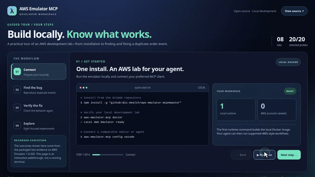

  

<h1 align="center">AWS Emulator MCP</h1>

<strong>Your AWS playground. Controlled by your AI assistant.</strong>

  Explore AWS APIs, test application workflows, and catch bugs before deployment.
  All from a local, isolated development environment. <strong>No AWS account required.</strong>

  
  
  

  <a href="#get-started">Get started</a> ·
  <a href="docs/DEMO_GALLERY.md">Watch the demos</a> ·
  <a href="docs/ONBOARDING.md#interactive-tour">Guided tour</a> ·
  <a href="#connect-your-ai-assistant">Connect your assistant</a> ·
  <a href="docs/COVERAGE.md">Service coverage</a>

  

<a href="docs/assets/demos/product-tour.mp4">Watch the guided walkthrough (25s)</a> · <a href="docs/assets/demos/fix-the-bug.mp4">Bug-fix demo (22s)</a> · <a href="docs/assets/demos/getting-started.mp4">Getting started (16s)</a>

## See what your agent can do

**Catch an application bug.** Our sample Python order service writes to DynamoDB, stores an S3 receipt, and sends a fulfillment message through SQS. When a client retries, the buggy version sends the event twice. A conditional DynamoDB write fixes it.

| After two identical requests | Before | After |
|:--|--:|--:|
| Accepted orders | **2** | **1** |
| SQS fulfillment messages | **2** | **1** |
| Resource cleanup checks | **7/7** | **7/7** |

The [application walkthrough](docs/APP_DEBUGGING.md) includes the Python source, exact patch, run-by-run assertions, and a [saved test result](docs/evidence/app-debug-aws-emulator-1.0.365.json). This demo runs the bundled reference fix; it does not execute code supplied by an agent.

## Get started

**Requires:** Node.js 20+, running Docker Desktop or Docker Engine, and an internet connection for the first image build.

~~~bash
npm install -g "github:B11-Health/aws-emulator-mcp#master"

# Run the before-and-after application test
aws-emulator-mcp app-debug compare

# Explore the available experiments
aws-emulator-mcp experiments
~~~

The launcher is currently installed from GitHub (it is **not yet published on npm**). The first runtime command builds a Docker image using the signed AWS Emulator package; later runs reuse that image. For a reproducible setup, [pin a tested commit](docs/DOCKER_NPM_BETA.md) instead of the moving master branch.

## Connect your AI assistant

~~~bash
aws-emulator-mcp config vscode
aws-emulator-mcp config copilot
~~~

Copy the generated MCP configuration into a compatible local client. It runs over standard input/output, without exposing a public server.

**Try this prompt:**

> Inspect the order-intake sample, explain why a retry publishes two fulfillment messages, and run the before-and-after test. Show me the code change and confirm whether cleanup passed.

The local MCP tools **app_debug_catalog** and **app_debug_run** expose the packaged source and its test results. [Follow the onboarding guide](docs/ONBOARDING.md) for Windows, macOS, and Linux setup.

## Explore the lab

| Workflow | Try it |
|:--|:--|
| Duplicate-order debugging | `aws-emulator-mcp app-debug compare` |
| SNS → SQS message delivery | `aws-emulator-mcp experiment sns-sqs-delivery` |
| EC2 network lifecycle | `aws-emulator-mcp experiment ec2-vpc-lifecycle` |
| Recover a missing S3 object | `aws-emulator-mcp experiment s3-recovery` |
| Discover the full catalog | `aws-emulator-mcp experiments` |
| Check selected AWS API responses | `aws-emulator-mcp coverage` |

Eight built-in experiments exercise S3, DynamoDB, SQS, SNS, EC2, EventBridge, SSM Parameter Store, and Secrets Manager workflows. The application debugging example uses three AWS services together. All scenarios operate on synthetic local resources and verify scoped cleanup. [Browse the demos](docs/DEMO_GALLERY.md) or [read the experiment guide](docs/EXPERIMENT_LABS.md).

## What's under the hood?

  

- **29 curated MCP tools**, plus **5 Docker-only tools** for SDK discovery, invocation, coverage, and the packaged app debugger.
- **436 service models** available through the installed AWS SDK. Model discovery does **not** mean every operation is supported by the emulator.
- **20/20 read-only API probes** responded in the recorded v1.0.343 coverage run. The selected probes also responded in a subsequent v1.0.365 run.
- A [coverage comparison command](docs/COVERAGE.md) helps spot response regressions between emulator versions.

The Docker integration uses local-only, network-isolated runtime containers and emulator-issued credentials. AWS Emulator is intended for development and testing, **not production AWS**; API fidelity and IAM behavior vary. See the [coverage report](docs/COVERAGE.md) and [security notes](SECURITY.md).

## Documentation and contributing

[Guided onboarding](docs/ONBOARDING.md) · [Demo gallery](docs/DEMO_GALLERY.md) · [Application debugging](docs/APP_DEBUGGING.md) · [Service coverage](docs/COVERAGE.md) · [Architecture and setup](docs/DOCKER_NPM_BETA.md) · [Contributing](CONTRIBUTING.md) · [Issues](https://github.com/B11-Health/aws-emulator-mcp/issues)

---

AWS Emulator MCP is an independent open-source integration maintained under the B11-Health GitHub account. AWS Emulator itself is an <a href="https://github.com/aws/aws-emulator">AWS project</a>. This integration is not affiliated with or endorsed by AWS.
