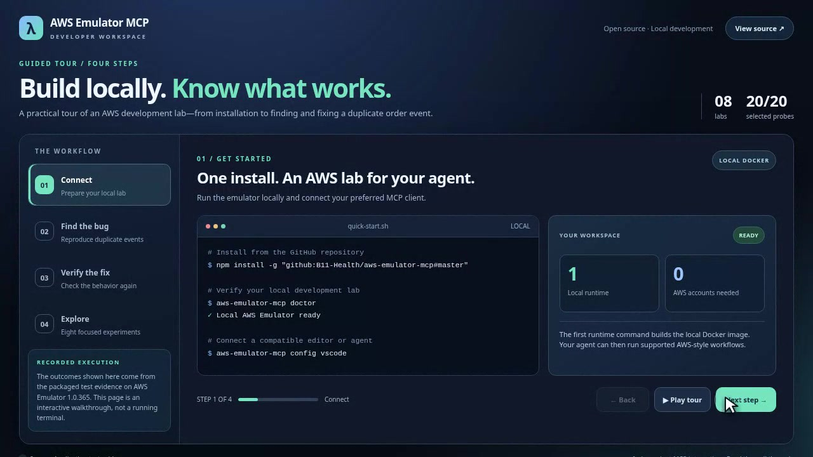
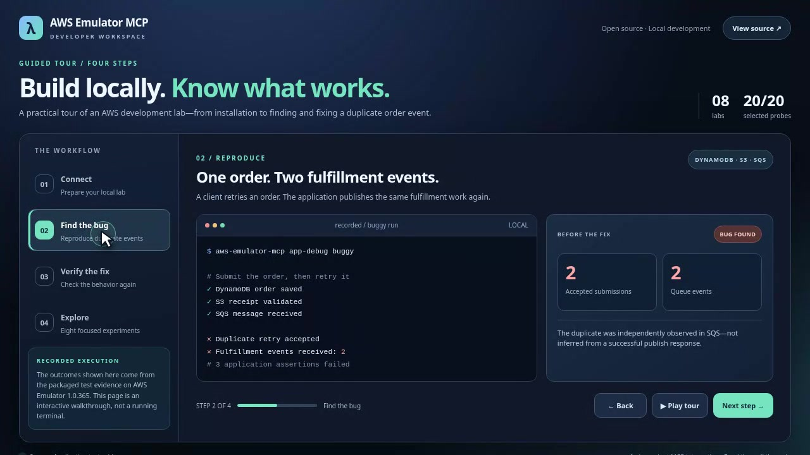
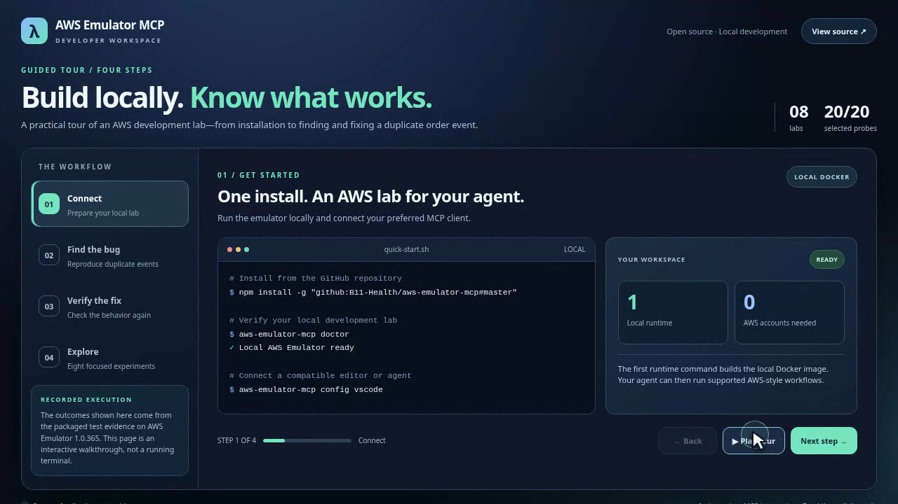
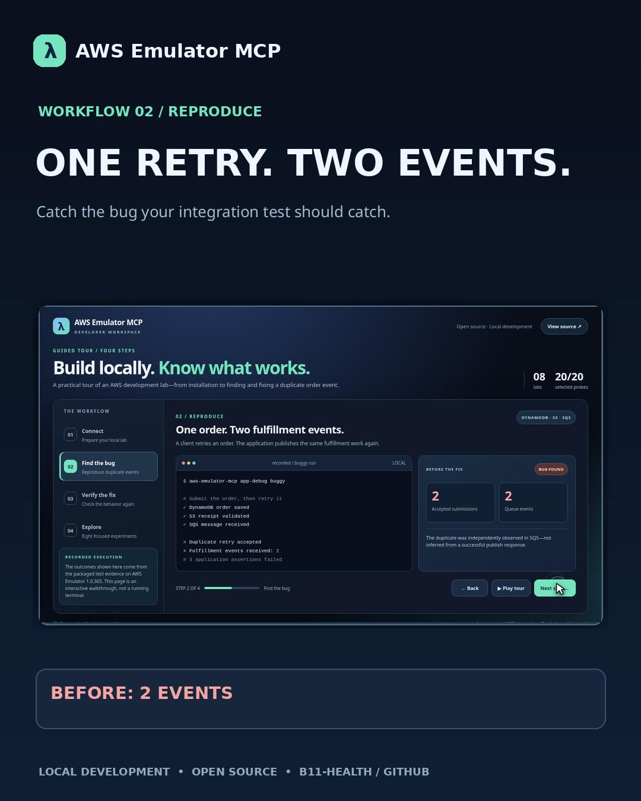

# Watch AWS Emulator MCP in action

A short introduction is more useful than a wall of commands. Start with the product tour, then choose the workflow you want to try.

All clips are **caption-led and silent**, with a visible guided mouse pointer. The interface presents results from saved local AWS Emulator test runs; it is a walkthrough, not a live connection or an AI patch-generation session. The source and measured API results are linked below.

## Product tour · 25 seconds

**[Watch: Product tour](assets/demos/product-tour.mp4)** — Connect → reproduce a duplicate order → verify the reference fix → explore service labs.

## Debug an order-processing bug · 22 seconds

**[Watch: Fix the bug](assets/demos/fix-the-bug.mp4)** — Two fulfillment events before the DynamoDB conditional write, one after. The actual Python application, patch, and saved results are in the [debugging walkthrough](APP_DEBUGGING.md).

## Get started · 16 seconds

**[Watch: Getting started](assets/demos/getting-started.mp4)** — Install the launcher, connect an MCP client, and choose an experiment. [Installation walkthrough](ONBOARDING.md).

## LinkedIn launch cut · 21 seconds

**[Watch: Launch video (4:5)](assets/demos/linkedin-launch.mp4)** — An easy-to-share overview of the duplicate-event example and the development workflow.

## Explore the interactive onboarding

The [tour source](onboarding/index.html) includes step navigation and a pointer-follow highlight. To run the interactive version after cloning the repository, from its root:

~~~bash
python3 -m http.server 8765 --bind 127.0.0.1
~~~

Then open **http://127.0.0.1:8765/docs/onboarding/**. The tour works without a network connection or Docker and does not execute API calls. You can use the step buttons, arrow controls, or **Play tour** to move through the four stages. The guided pointer and hover highlight work with a mouse; touch screens use the step controls.

## Reproduce the demonstrated application test

~~~bash
npm install -g "github:B11-Health/aws-emulator-mcp#master"
aws-emulator-mcp app-debug compare --json
~~~

You can inspect the [recorded v1.0.365 application evidence](evidence/app-debug-aws-emulator-1.0.365.json) and the [patch](../examples/order-intake/reference.patch). The fixed variant is a packaged reference implementation; executing arbitrary AI-authored patches is outside the current beta.

The videos have no narration or soundtrack by design. They are edited guides; the live API results are available through the CLI and source-based tests.
