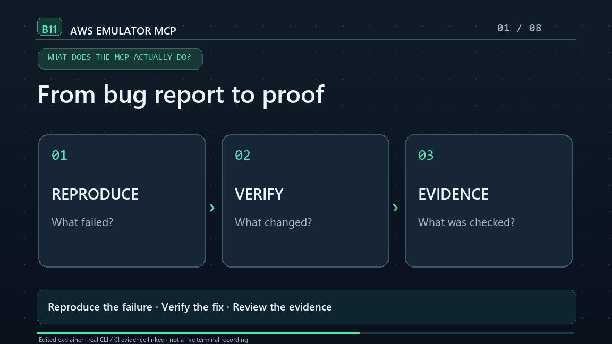
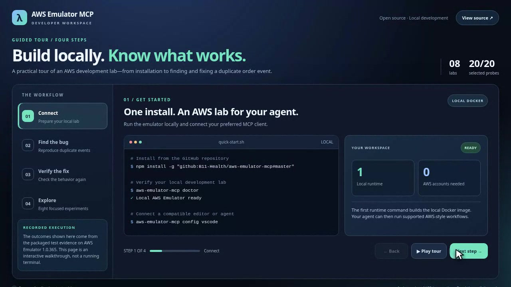
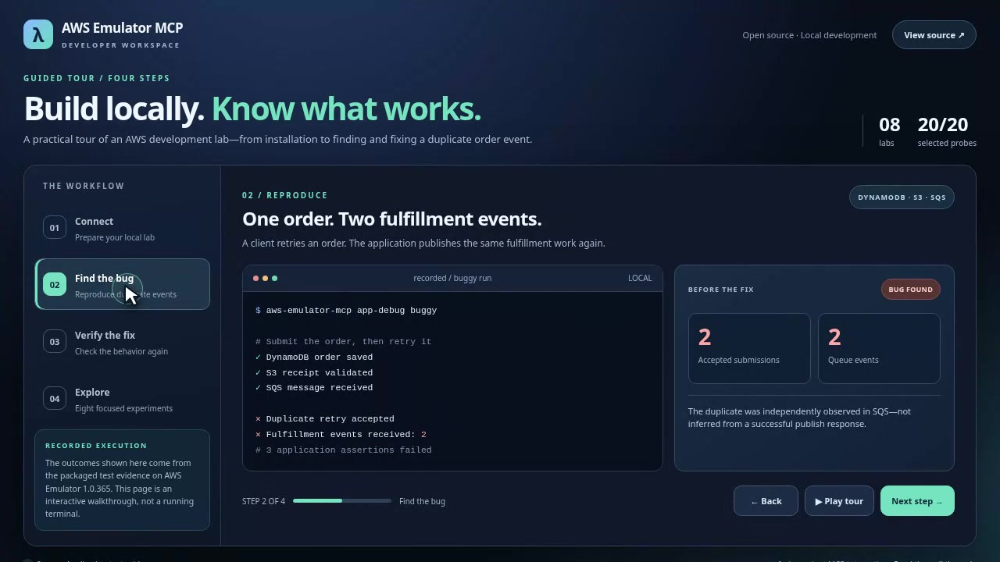
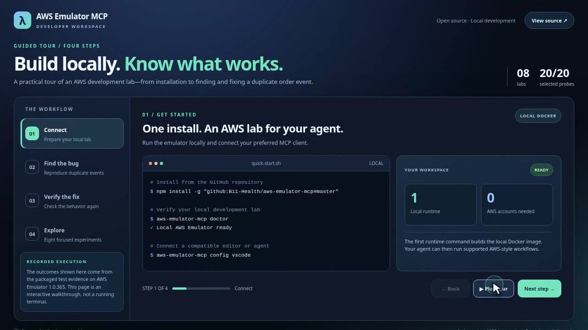
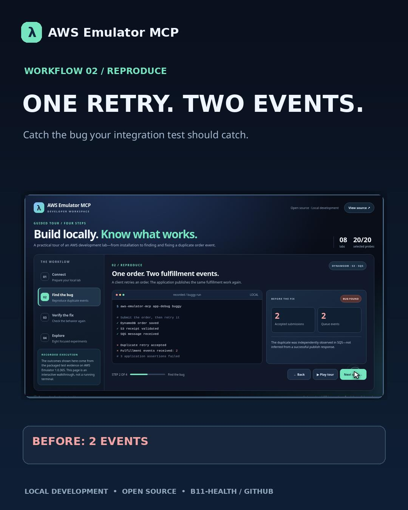
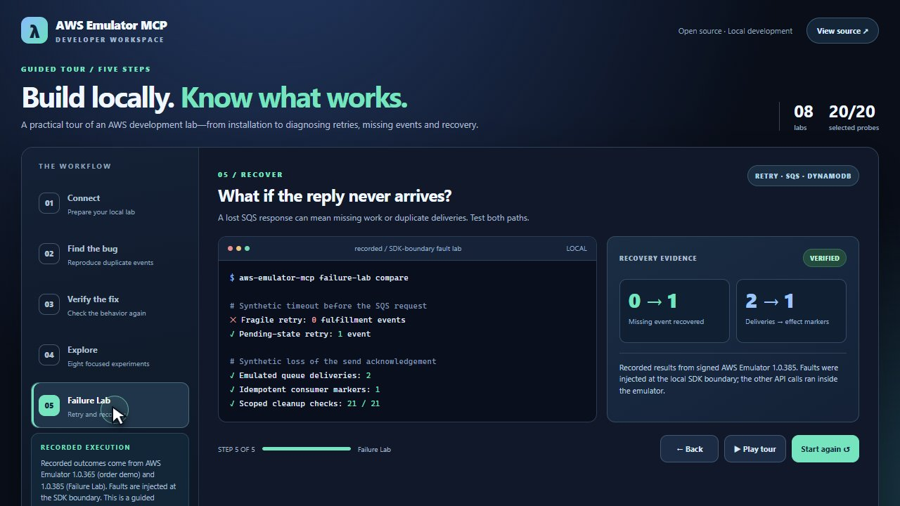

# Watch AWS Emulator MCP in action

A short introduction is more useful than a wall of commands. Start with the product tour, then choose the workflow you want to try.

The new beta.15 walkthrough has **spoken narration and English captions**. The older clips below are silent and caption-led. All are edited explainers based on source code or recorded emulator test results, **not continuous live terminal sessions**. Run the documented commands to reproduce the tests yourself.

## Beta.15: from first run to failure-proof workflow · 87 seconds

[](assets/demos/proof-first-beta15.mp4)

**[Watch the narrated demo](assets/demos/proof-first-beta15.mp4)** · [English captions](assets/demos/proof-first-beta15.vtt) · [Accessible transcript](SHOWCASE_TRANSCRIPT.md) · [Interactive six-mission demo studio](index.html)

The video explains the **offline first run**, a duplicated SQS event fixed by a DynamoDB conditional write, a **synthetic** failed S3 receipt upload and retry, trusted-local Python handler comparisons, source-level architecture review, and local MCP client configuration. [Claims and measured evidence](SHOWCASE_EVIDENCE.md).


## Four bite-size beta.15 demos

Each clip is a narrated excerpt from the full tutorial, with a visible
explanatory caption and corresponding section in the [transcript](SHOWCASE_TRANSCRIPT.md).
The illustrated tests are **not live terminal capture**.

| Start here | Watch | What to try afterward |
| --- | --- | --- |
| **First 30 seconds** — zero Docker | [12-second quickstart](assets/demos/beta15-quickstart-demo.mp4) | Run the offline command to verify seven artifacts |
| **Duplicate order and partial-write recovery** | [21-second reliability demo](assets/demos/beta15-reliability-demo.mp4) | Run the reviewed sample application and synthetic S3 timeout |
| **Your trusted Python fix and a risky schema change** | [22-second source-review demo](assets/demos/beta15-source-review-demo.mp4) | Compare two trusted local handlers; inspect architecture risk flags |
| **Connect a coding assistant** | [9-second MCP setup demo](assets/demos/beta15-connect-agent-demo.mp4) | Generate VS Code MCP configuration; Docker required for actual emulator tools |

[All six copyable demo missions](index.html) · [Actual beta.15 QA evidence](SHOWCASE_EVIDENCE.md)

## Product tour · 25 seconds

[](assets/demos/product-tour.mp4)

**[Watch: Product tour](assets/demos/product-tour.mp4)** — Connect → reproduce a duplicate order → verify the reference fix → explore service labs.

## Debug an order-processing bug · 22 seconds

[](assets/demos/fix-the-bug.mp4)

**[Watch: Fix the bug](assets/demos/fix-the-bug.mp4)** — Two fulfillment events before the DynamoDB conditional write, one after. The actual Python application, patch, and saved results are in the [debugging walkthrough](APP_DEBUGGING.md).

## Get started · 16 seconds

[](assets/demos/getting-started.mp4)

**[Watch: Getting started](assets/demos/getting-started.mp4)** — Install the launcher, connect an MCP client, and choose an experiment. [Installation walkthrough](ONBOARDING.md).

## LinkedIn launch cut · 21 seconds

[](assets/demos/linkedin-launch.mp4)

**[Watch: Launch video (4:5)](assets/demos/linkedin-launch.mp4)** — An easy-to-share overview of the duplicate-event example and the development workflow.

## Try the failure-and-recovery lab

The recorded beta.15 walkthrough now includes this workflow. You can
reproduce the earlier failure comparison through the installed CLI:

```bash
aws-emulator-mcp failure-lab compare
```

It reproduces a lost order event after a synthetic SDK timeout, shows the
recoverable pending-state strategy, and verifies one consumer-effect marker
after two SQS messages caused by a lost acknowledgement.
[See the scenario and source](FAILURE_LAB.md).

## Failure Lab: missing events and lost acknowledgements · 20 seconds

[](assets/demos/failure-lab.mp4)

**[Watch: Failure Lab](assets/demos/failure-lab.mp4)** — A guided pointer highlights
three measured outcomes: zero messages from a fragile retry, one message
after pending-state recovery, and two delivered messages with one idempotent
consumer-effect marker after an acknowledgement was lost.

The clip is a browser walkthrough of [recorded signed-emulator evidence](evidence/failure-lab-aws-emulator-1.0.385.json).
It does not show a live terminal or claim that the emulator itself dropped a
packet. [Reproduce the scenario](FAILURE_LAB.md).

## Explore the interactive onboarding

The [tour source](onboarding/index.html) includes step navigation and a pointer-follow highlight. To run the interactive version after cloning the repository, from its root:

~~~bash
python3 -m http.server 8765 --bind 127.0.0.1
~~~

Then open **http://127.0.0.1:8765/docs/onboarding/**. The tour works without a network connection or Docker and does not execute API calls. You can use the step buttons, arrow controls, or **Play tour** to move through the five stages. The guided pointer and hover highlight work with a mouse; touch screens use the step controls.

## Reproduce the demonstrated application test

~~~bash
npm install -g "github:B11-Health/aws-emulator-mcp#v0.4.0-beta.15"
aws-emulator-mcp app-debug compare --json
~~~

You can inspect the [recorded v1.0.365 application evidence](evidence/app-debug-aws-emulator-1.0.365.json) and the [patch](../examples/order-intake/reference.patch). The fixed variant is a packaged reference implementation; executing arbitrary AI-authored patches is outside the current beta.

The beta.15 video has narration and captions; older videos remain silent. These are edited guides. Actual API results are verified through the CLI and linked CI/source-based tests.
